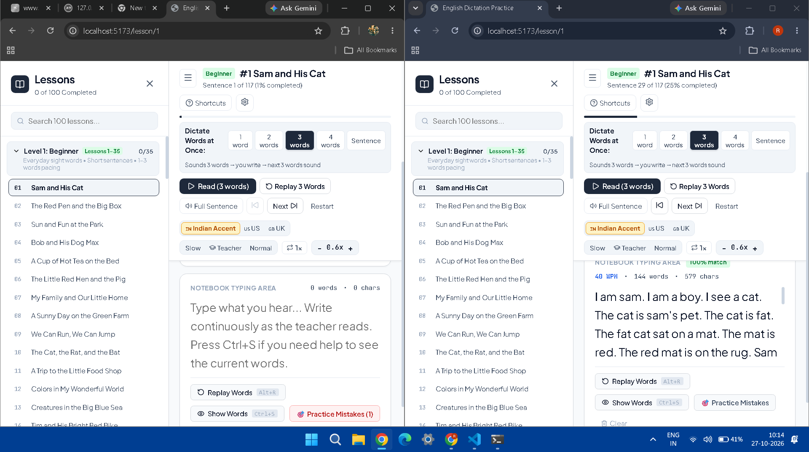
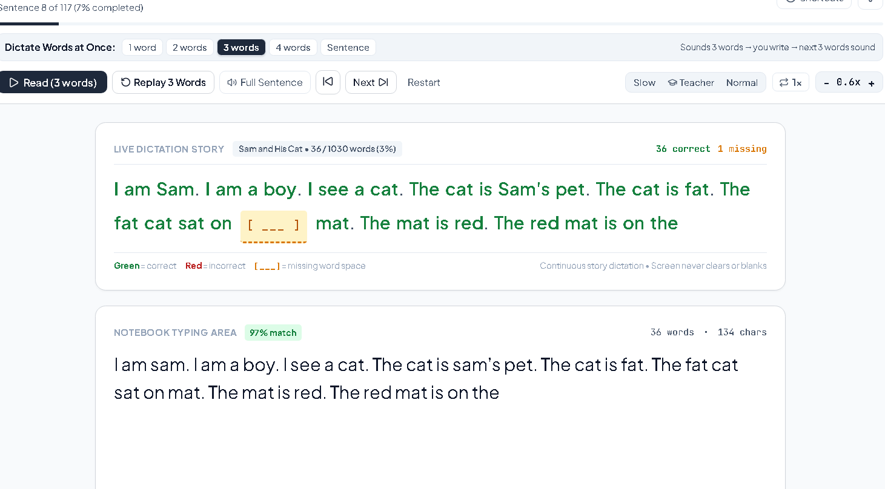

# English Dictation Practice

An advanced English dictation and auditory transcription platform designed to build English listening comprehension, spelling accuracy, touch typing speed, and active vocabulary acquisition through continuous real-time story dictation.



---

## Highlights & Key Features

### 1. 100 Progressive Lessons (~100,000 Words)
The curriculum is organized into three balanced difficulty tiers with **950 to 1,050 words per lesson** (over 100,000 total words):
- **Level 1: Beginner (Lessons 1–35)**:
  - Everyday sight words, short vowels, basic consonants, simple present & past tenses.
  - Phonics patterns and simple sentence structures (*"I am Sam."*, *"The cat is on the mat."*, *"We go to the park."*).
- **Level 2: Intermediate (Lessons 36–70)**:
  - Compound and complex sentences, everyday dialogues, travel stories, campus life, budgeting, cooking, and workplace communication.
- **Level 3: Advanced (Lessons 71–100)**:
  - Sophisticated academic, technical, philosophical, and professional discourse.
  - Complex idioms, nuanced clauses, habit formation neurobiology, ethics, literature craft, and high-stakes negotiation.

### 2. Natural 3-Word Chunk Dictation
- Dictates **3 words at a time** by default:
  1. The teacher speaks 3 words.
  2. You write them in the notebook typing area.
  3. As soon as you type them, the teacher speaks the **next 3 words** automatically.
- Dictation pacing is fully customizable anytime from the top bar:
  - `1 word`, `2 words`, `3 words` (*Default*), `4 words`, or `Sentence` (full sentence mode).

### 3. Real-Time Word Sequence Alignment
- Uses a **Dynamic Programming sequence alignment algorithm** (Needleman-Wunsch variant) rather than naive index comparison.
- Skipping a word or making a typo never causes downstream false negatives.
- **Color Coding**:
  - <strong style="color: #22c55e;">Green</strong>: Correct word.
  - <strong style="color: #ef4444;">Red</strong>: Incorrect word (shows your typed letters with wavy underline; does not spoil correct spelling).
  - <strong style="color: #fbbf24;">[ ___ ]</strong>: Distinct missing space indicator showing where a word was skipped.
  - **Untyped words**: Remain invisible so the story is never spoiled before you hear it.



### 4. "Show Missing Words" & Instant Insertion
- If you miss a word, click **"Show Missing Words"** in the Live Story header to replace `[ ___ ]` with the expected word `[ word ]`.
- Click the **`+ Insert`** button to automatically append the missing word into your typing notebook without retyping.

### 5. High-Clarity Audio & Pronunciation Tools
- **🇮🇳 Indian Accent by Default**: Optimized for natural Indian English voices (`Microsoft Neerja Online Natural`, `Microsoft Heera`, `Google en-IN`, `Apple Rishi/Veena`), with one-click toggles for 🇺🇸 US and 🇬🇧 UK accents.
- **"Slow & Clear" Audio**: When a word or phrase is difficult to understand, click the **"Slow & Clear"** button (<kbd>Volume</kbd>) to hear it articulated at `0.65×` speed with distinct consonants and syllables.
- **Speech Sanitizer**: Automatically cleans raw punctuation, quotation marks, and brackets before audio synthesis to prevent audio clipping, stutters, or slurring.
- **Sound-Wave Visualizer**: Animated equalizer visualizer confirms when the audio teacher is actively speaking.

### 6. Click-to-Define Vocabulary Dictionary
- Click any word in the continuous live story to open an instant offline vocabulary card showing:
  - Word definition and part of speech
  - Phonetic pronunciation
  - Normal pronunciation and Slow Pronunciation audio buttons
  - Real-world example sentence

### 7. Modern Dark Mode & Tailwind CSS UI
- Built with **Tailwind CSS** and dark mode by default (`#090d16` canvas, `#111827` surface cards, `#1e293b` muted controls, crisp `#f8fafc` text).
- **Collapsible Sidebar**: Easily collapse or expand the 100-lesson sidebar using the **"Hide"** button or pressing <kbd>Ctrl + \</kbd>.
- **Full-Width Responsive Layout**: Panels stretch smoothly across 100% of your monitor with zero wasted margin space.
- **Live Typing Stats**: Real-time Words-Per-Minute (WPM) gauge and live match percentage indicator.

### 8. SQLite Database & Cross-Browser Synchronization
- High-performance **SQLite database** (`better-sqlite3` with Write-Ahead Logging `WAL` mode) running on the Node.js backend.
- Automatically saves and restores typed continuous story text across page refreshes, tabs, and different browsers.

---

## How to Use the Project

### Prerequisites
- **Node.js**: v18.0.0 or higher (tested with Node.js v22)
- **npm**: v9.0.0 or higher

### Step 1: Install Dependencies
Open your terminal in the project directory and run:
```bash
npm install
```

### Step 2: Start the Development Server
Run the concurrent dev command to start both the SQLite backend API server (port 3001) and Vite frontend (port 5173):
```bash
npm run dev
```

### Step 3: Open in Browser
Navigate to:
```
http://localhost:5173
```
The application will automatically load your last active lesson or start at **Lesson #1: Sam and His Cat**.

### Step 4: Dictation Workflow
1. Click **"Read (3 words)"** or press <kbd>Ctrl + Enter</kbd> to begin.
2. Listen to the teacher speak the first 3 words.
3. Type what you hear in the **Notebook Typing Area**.
4. Watch your words appear in the **Live Dictation Story**:
   - Correct words turn green.
   - Mistyped words turn red.
   - Skipped words show as `[ ___ ]`.
5. As soon as you finish the 3 words, the next 3 words sound automatically.
6. If you miss a word, click **"Slow & Clear"** or press <kbd>Alt + R</kbd> to replay.
7. Upon completing all words in the lesson, the **Lesson Complete Summary Modal** provides accuracy metrics, total words, elapsed time, and tricky words to review.

---

## Keyboard Shortcuts

| Shortcut | Description |
| :--- | :--- |
| <kbd>Ctrl + \</kbd> | Toggle / Hide Lessons Sidebar |
| <kbd>Ctrl + Enter</kbd> | Start or resume audio dictation |
| <kbd>Alt + R</kbd> | Replay current words |
| <kbd>Alt + P</kbd> | Pause or resume speech |
| <kbd>Ctrl + S</kbd> | Show / hide current words hint (Help peek) |
| <kbd>Alt + →</kbd> | Skip to next chunk / sentence |
| <kbd>Alt + ←</kbd> | Go back to previous chunk / sentence |
| <kbd>Escape</kbd> | Pause speech or close open modal |

---

## Available Scripts

| Command | Description |
| :--- | :--- |
| `npm run dev` | Starts Vite and launches the Electron desktop application with hot reload |
| `npm run dev:electron` | Explicit alias for starting the Electron development environment |
| `npm run dev:web` | Starts the Express server and Vite in web browser mode |
| `npm start` / `npm run electron` | Launches the built Electron desktop application using local files |
| `npm run server` | Starts only the Node.js / SQLite backend API server (port 3001) |
| `npm run client` | Starts only the Vite development frontend (port 5173) |
| `npm test` | Runs the Vitest test suites (53 tests across 9 suites) |
| `npm run build` | Compiles TypeScript and builds production bundles to `dist/` |
| `npm run preview` | Previews the production build locally |

---

## Project Structure

```
dictation/
├── docs/
│   └── screenshots/              # Application screenshots & feature previews
├── server/
│   ├── data/
│   │   ├── dictation.db          # SQLite database (stores progress, stories, settings)
│   │   ├── dictation.db-shm      # SQLite shared memory
│   │   └── dictation.db-wal      # SQLite write-ahead log
│   ├── db.js                     # SQLite schema, queries, and migrations
│   └── index.js                  # Express API server (REST endpoints)
├── src/
│   ├── components/
│   │   ├── FeedbackPanel.tsx     # Continuous story feedback, missing words, vocabulary card
│   │   ├── LessonSummaryModal.tsx# Completion modal, accuracy report & tricky words
│   │   ├── SettingsModal.tsx     # Voice accent, specific voices, speed & modes
│   │   ├── ShortcutsModal.tsx    # Keyboard shortcuts cheat sheet
│   │   ├── Sidebar.tsx           # Collapsible 100-lesson curriculum navigation
│   │   ├── TopControlsBar.tsx    # Audio controls, speed stepper, sidebar toggle
│   │   └── TypingPanel.tsx       # Notebook typing area, WPM meter, slow pronunciation
│   ├── data/
│   │   ├── lessons/              # 100 JSON lesson files (~1,000 words each)
│   │   ├── lessonsIndex.ts       # Dynamic lesson loaders
│   │   └── lessonsManifest.json  # Metadata manifest for all 100 lessons
│   ├── services/
│   │   ├── dictionary.ts         # Offline English learner dictionary service
│   │   ├── speechEngine.ts       # Web Speech API wrapper with Indian accent prioritization
│   │   └── storage.ts            # Client sync service with SQLite backend API
│   ├── utils/
│   │   ├── chunker.ts            # 3-word chunking and boundary calculation
│   │   └── evaluator.ts          # Needleman-Wunsch sequence alignment evaluator
│   ├── types/
│   │   └── index.ts              # TypeScript type definitions
│   ├── App.tsx                   # Main dictation page container & router routes
│   ├── index.css                 # Tailwind CSS directives & theme variables
│   └── main.tsx                  # React DOM mount point
├── tests/
│   ├── chunker.test.ts           # Sentence chunking tests
│   ├── curriculum.test.ts        # Curriculum validation (100 lessons, 100k words)
│   ├── dictionary.test.ts        # Dictionary lookups and morphology tests
│   ├── evaluator.test.ts         # Sequence alignment evaluation tests
│   ├── server.test.ts            # Express backend endpoints tests
│   ├── speechEngine.test.ts      # Speech synthesis, voice selection, text sanitizer tests
│   ├── sqlite.test.ts            # SQLite database queries and persistence tests
│   └── storage.test.ts           # Local storage caching tests
├── postcss.config.js             # PostCSS configuration for Tailwind CSS
├── tailwind.config.js            # Tailwind CSS theme extension
├── tsconfig.json                 # TypeScript compiler configuration
└── vite.config.ts                # Vite build and proxy configuration
```

---

## Technical Architecture

- **Desktop Framework**: Electron v45 with secure `contextBridge` preload isolation and native IPC communication.
- **Frontend**: React 19, TypeScript, Vite, Tailwind CSS, Lucide Icons, Canvas Confetti.
- **Database Layer**: `better-sqlite3` embedded directly in the Electron main process via IPC channels (eliminating localhost HTTP server overhead, port conflicts, and OS firewall prompts), with fallback HTTP server for web mode.
- **Routing**: React Router DOM (`/lesson/:id`) with automatic deep-linking and state preservation.
- **Audio Engine**: Web Speech API (`SpeechSynthesis`) with natural voice discovery, pronunciation text preprocessing, and syllable speed controls.
- **Evaluation Engine**: Dynamic Programming matrix alignment algorithm providing instantaneous $O(N \times M)$ token matching without false-negative cascade.
